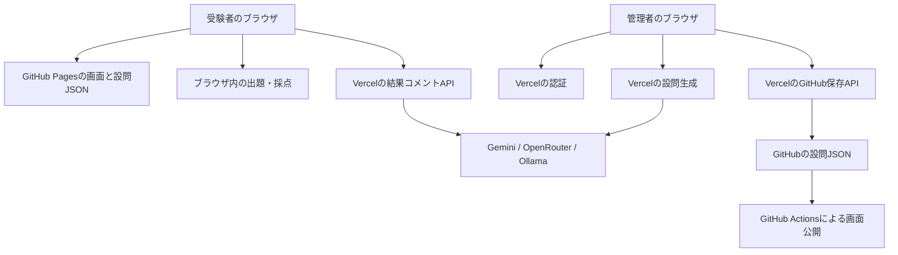

# AIリテラシー検定：現状仕様・実装状況の調査

調査日：2026-10-18（日本時間）

## 1. 調査の前提

このアプリは、設問JSONをブラウザで読み込み、ブラウザ内で出題と採点を行います。VercelのAPIは、AIコメント、管理者認証、AI設問生成、GitHubへの保存を担当します。そのため、「受験本体が実装されていること」と「外部のAI・保存機能が本番で動くこと」は、分けて確認する必要があります。

- 対象：[gerupon-lgtm/ai-literacy-test](https://github.com/gerupon-lgtm/ai-literacy-test)
- 基準コミット：[`e4708bd593f4d6daf0ec5a2ca95d4ff65304cb3f`](https://github.com/gerupon-lgtm/ai-literacy-test/commit/e4708bd593f4d6daf0ec5a2ca95d4ff65304cb3f)
- 基準コミットの更新：2026-10-18 15:27:06 JST
- 調査対象：GitHub上のコード、README、設問データ、公開処理の設定、GitHub ActionsとVercelの配備情報。
- GitHub上のコード・設定・設問、本番環境は変更していない。この報告書のみローカルに追加。
- ローカル作業フォルダにはZIPと設問JSONがあり、Gitの作業用コピーはなかった。今回はGitHub上の指定コミットを正とし、一時フォルダへ取得して確認した。ZIPを最新版とは扱っていない。
- READMEは現状説明と過去の説明が混在している。以下はコードから整理した現状であり、新しい仕様を合意・承認したものではない。
- READMEやコードが参照する別の「仕様書」「設計書」は、対象コミットのファイル一覧にはない。

## 2. 現在の公開設定

| 項目 | 確認内容 |
|---|---|
| 画面とREADMEのアプリ版 | ver 1.1.2 |
| package.jsonの版 | 1.0.0（画面表記と不一致） |
| 現在の検定名 | 情報セキュリティ検定 |
| テーマ | 情報セキュリティ |
| 出題セットID | it-security-2026-10 |
| 設問セット版 | 1.0.3 |
| 設問在庫 | 100問（単一選択96問・複数選択4問） |
| 1回の出題数 | 20問 |
| 合格ライン | 70% |
| 問題・選択肢の順番 | 両方ランダム |
| 表示上の所要時間 | 14分（1問40秒の計算。制限時間ではない） |
| フロントのAPI接続先 | https://ai-literacy-test-ten.vercel.app |

現在の20問のカテゴリ配分は次のとおり。カテゴリ内から無作為に選び、全体の順番も混ぜるため、100問から完全に均等確率で20問を選ぶ方式とは異なる。

| カテゴリ | 在庫 | 1回の出題 |
|---|---:|---:|
| メールとリンクの扱い | 12 | 3 |
| なりすましへの注意 | 12 | 3 |
| アカウント・パスワード | 12 | 2 |
| 顧客情報の取り扱い | 12 | 2 |
| 情報の置き場所とバックアップ | 11 | 2 |
| 端末・ネットワーク・物理 | 11 | 2 |
| 外部サービス・生成AI | 10 | 2 |
| インシデント対応・報告 | 10 | 2 |
| 最新の脅威と手口 | 10 | 2 |

重みの比率で整数の問題数を計算し、端数が大きいカテゴリから残りを配る。同点では優先度の小さい数字を優先する。カテゴリ在庫が不足した場合は他のカテゴリから補充するため、設定した配分が崩れる場合がある。

根拠：[現在の設問セット](https://github.com/gerupon-lgtm/ai-literacy-test/blob/e4708bd593f4d6daf0ec5a2ca95d4ff65304cb3f/public/data/current-question-set.json)、[使用中セット指定](https://github.com/gerupon-lgtm/ai-literacy-test/blob/e4708bd593f4d6daf0ec5a2ca95d4ff65304cb3f/public/data/active-set.json)、[出題処理](https://github.com/gerupon-lgtm/ai-literacy-test/blob/e4708bd593f4d6daf0ec5a2ca95d4ff65304cb3f/public/assets/js/quiz.js)、[配分計算](https://github.com/gerupon-lgtm/ai-literacy-test/blob/e4708bd593f4d6daf0ec5a2ca95d4ff65304cb3f/public/assets/js/scoring.js#L116)

## 3. 利用者向けの仕様と実装

### 受験

1. トップで検定名、説明、セットID・版、問題数、所要時間目安、合格ラインを表示する。
2. 設問の総数が必要数に足りない場合は開始を禁止する。
3. 単一選択・複数選択で回答する。未選択のまま次へは進めない。
4. 前の設問に戻って回答を変更できる。中断するとトップへ戻り、再開始では新たに出題する。
5. 数字キーで選択肢、Enterで次へ、左矢印で前の設問へ移動できる。
6. 最後の回答後、集計・コメント待機を経て結果を表示する。
7. 回答状態はメモリ内だけに保持する。ページ再読み込み後の再開機能はない。

### 採点・結果

- 各問は同じ配点。複数選択は正解集合との完全一致のみ正解で、部分点はない。
- 点数は正答率を四捨五入した0〜100点。
- ランクはS＝90点以上、A＝80点以上、B＝70点以上、C＝60点以上、D＝60点未満。
- 合否はセットの合格ラインで別に判定する。合格ラインを変更してもランクの境界は変わらない。
- カテゴリ別正答率、レーダーチャート、間違えた問題の本文と解説を表示する。
- 復習欄には、自分が選んだ選択肢と正解の選択肢の対比表示はない。
- 得意カテゴリは80%以上、苦手カテゴリは60%未満。
- 「偏差値」は他の受験者との比較ではなく、点数を固定式で変換した参考値。式は `50 + (点数 - 70) / 2` を四捨五入して30〜75に収める。通常の0〜100点では実際には30〜65となる。
- 受験者登録、受験履歴DB、管理者による結果一覧、集団平均との差の計算、制限時間、正式な認定証の仕組みは見当たらない。これらを未達要件とは扱っていない。
- 正解を含むJSONをブラウザへ渡す構造なので、位置付けはセルフチェック。正解を受験者端末から隠す構造にはなっていない。

### AIコメント・保存・共有

- 採点にAIは使用しない。AIは点数・カテゴリ別傾向から理解度コメントを作る。
- 送信する通常のデータには氏名、個別の回答内容、設問全文を含めない。検定名・テーマも送る。
- AI呼び出し失敗時は定型コメントに切り替え、結果表示を続ける。
- APIクライアントの通信上限は20秒。画面側に別途25秒の待機上限がある。
- 結果コピー、CSV保存、PNG保存、ブラウザからの共有が実装されている。
- PNG保存ボタンはスコア・レーダー・カテゴリ別棒グラフを1枚に合成する。失敗時はレーダー単独を試す。
- メール共有のPNGはレーダー単独で、PNG保存ボタンと同じ画像ではない。
- 対応端末では共有シートを使う。非対応ではCSV・TXT・PNGを保存してメール作成画面を開く。添付は利用者が行い、サーバーから自動送信する方式ではない。
- CSVにはスコア・ランク・正答数・問題数・参考偏差値・カテゴリ集計が入る。AIコメント、検定名、セットID・版、合否は入らない。結果の出典を後から識別する情報は十分でない。

根拠：[受験画面制御](https://github.com/gerupon-lgtm/ai-literacy-test/blob/e4708bd593f4d6daf0ec5a2ca95d4ff65304cb3f/public/assets/js/app.js)、[採点](https://github.com/gerupon-lgtm/ai-literacy-test/blob/e4708bd593f4d6daf0ec5a2ca95d4ff65304cb3f/public/assets/js/scoring.js)、[書き出し・共有](https://github.com/gerupon-lgtm/ai-literacy-test/blob/e4708bd593f4d6daf0ec5a2ca95d4ff65304cb3f/public/assets/js/export.js)、[画像生成](https://github.com/gerupon-lgtm/ai-literacy-test/blob/e4708bd593f4d6daf0ec5a2ca95d4ff65304cb3f/public/assets/js/chart.js)

## 4. 管理者向けの仕様と実装

| 機能 | 実装内容 |
|---|---|
| ログイン | サーバーの固定パスワードで照合し、署名付きの管理者トークンを発行。有効期限1時間 |
| ログイン状態 | ブラウザのメモリ内に保持。再読み込みで再ログイン。ログアウトは画面側でトークンを破棄 |
| ローカル確認 | API接続先が空の場合、非空パスワード入力で認証を省略。外部生成・GitHub保存は利用不可 |
| 現在の設問セット | ID、版、更新時刻、問題数、合格ライン、在庫を表示 |
| 出題設定 | 出題数、難易度、合格ライン、カテゴリの重みと優先度を設定 |
| AI設問生成 | 自然文の指示と配分を送信。既定5問、1〜10問ずつ分割生成 |
| 生成結果の確認 | 問題、選択肢、正解、解説をプレビューし、採用・破棄 |
| 再試行・不足補充 | バッチ失敗時に再試行。途中まで生成した問題の救出、不足分の追加生成にも対応 |
| モデル診断 | 各AIサービスのモデル一覧を取得。OpenRouterは小さな実リクエストを送る診断もある |
| 設問プール | 複数JSONを読み込み、統合、カテゴリ分類、重複候補表示、採用選択、本文等の編集 |
| 読み込み形式 | 設問セット、設問配列、questionSetDraft形式。ドラッグ＆ドロップにも対応 |
| 書き出し | JSONダウンロード、GitHub上の指定名への保存 |
| セット切替 | GitHub上の保管セットを選択し、公開用JSONへコピー |
| 操作記録 | アプリ独自の管理者操作ログはない。GitHubへの保存はコミットとして残る |

補足：

- 難易度設定はAI生成時の指示に使う。受験時に在庫の難易度を絞り込む実装ではない。
- 検定名、テーマ、説明、注記、ランク別コメントはJSONから引き継げる。専用の編集入力欄はない。
- ファイル読み込みと編集はブラウザ内。GitHub保存を押すとサーバーへデータを送信する。
- 類似度判定は問題文を2文字ずつ区切って重なりを比べる簡易方式。内容の正確性や実質的な同義性を保証しない。
- 管理者パスワードや外部サービスのキーをフロントへ置かない設計。実環境の秘密値は取得・確認していない。

根拠：[管理画面](https://github.com/gerupon-lgtm/ai-literacy-test/blob/e4708bd593f4d6daf0ec5a2ca95d4ff65304cb3f/public/admin.html)、[管理画面制御](https://github.com/gerupon-lgtm/ai-literacy-test/blob/e4708bd593f4d6daf0ec5a2ca95d4ff65304cb3f/public/assets/js/admin.js)、[プール処理](https://github.com/gerupon-lgtm/ai-literacy-test/blob/e4708bd593f4d6daf0ec5a2ca95d4ff65304cb3f/public/assets/js/pool.js)、[ログインAPI](https://github.com/gerupon-lgtm/ai-literacy-test/blob/e4708bd593f4d6daf0ec5a2ca95d4ff65304cb3f/api/admin-login.js)

## 5. 構成とデータの流れ

ブラウザの画面はHTML・CSS・JavaScriptで構成され、React等やビルド工程は使用していない。package.jsonに外部パッケージの依存宣言はなく、グラフ用のChart.js 4.4.1と日本語フォントは外部配信から読み込む。

### 主なファイル

| 場所 | 担当 |
|---|---|
| public/index.html / admin.html | 受験者画面・管理者画面 |
| public/assets/js/app.js / quiz.js / scoring.js | 画面進行・出題抽出・採点 |
| public/assets/js/branding.js | セットごとの名称・文言 |
| public/assets/js/chart.js / export.js | グラフ・結果画像・コピー・CSV・共有 |
| public/assets/js/admin.js / pool.js | 管理・生成案確認・設問編集 |
| public/assets/js/apiClient.js / config.js | API通信・接続先 |
| api/admin-login.js | 管理者認証 |
| api/analyze-result.js | 結果コメント |
| api/generate-questions.js | 設問生成 |
| api/list-models.js | モデル診断 |
| api/github-save.js | 設問の取得・保存・切替 |
| api/_lib.js / _providers.js | 認証・通信元設定・AIサービス共通処理 |
| tests/scoring.test.js | 採点・配分の既存テスト |

### 設問JSON

主な構造は、セットID・版・名称等、settings、categories、questions。問題はID・カテゴリ名・難易度・単一／複数選択・本文・選択肢・正解番号配列・解説・タグを持つ。正解番号は0始まり。

受験者が読むのは `public/data/current-question-set.json`。受験画面は `active-set.json` を直接たどらない。管理者APIが保管用の `sets/<ID>.json` を公開用JSONへコピーして切り替える。

| 保管用ファイル（public/data/sets/） | 在庫 | 出題数 |
|---|---:|---:|
| ai-literacy-it-engineer-2026-06-standard.json | 100 | 20 |
| ai-literacy-tax-office-2026-06-100.json | 100 | 20 |
| current-question-set.json | 52 | 20 |
| it-security-2026-10.json | 100 | 20 |
| sample-question-set.json | 20 | 20 |

`public/data/sets/current-question-set.json` と `public/data/current-question-set.json` は別の内容。前者は52問の過去セット、後者は現在の情報セキュリティ100問である。

### AI・公開

- AIの実装上の既定順はGemini → OpenRouter → Ollama。環境変数で順番とモデルを変更できる。
- 一時的な通信障害では、同じモデルの再試行と別モデル・別サービスへの切替を行う。
- 共通AI処理の1回の通信上限は55秒。複数回の再試行を合計した全体の制限時間ではない。
- Ollamaには既定の接続URLがあり、環境変数がなくても候補に入る。完全に無効化したい場合は接続順の設定が関わる。
- Vercel設定の関数最大時間は300秒。契約・実環境での実効上限は別途確認が必要。
- mainへのpushでGitHub Pages公開が走る。テストを実行してから公開する工程は、このワークフローにはない。
- サービスワーカー、PWA用の定義、オフライン用キャッシュ、受験結果DBは確認できない。
- レスポンシブ用CSSとキーボード操作は存在する。実機での使いやすさを確認済みとする根拠ではない。

## 6. 改修時に優先して扱いたい点

以下は発見事項と提案であり、改修方針の確定ではない。

### 優先1：公開中の編集内容と保管セットが同期しない

**理由・仕組み：** 「設定を反映」「生成案を採用」は `save_current` を呼び、公開用JSONだけを書き換える。切替時にコピー元となる保管用の `sets/<ID>.json` は更新しない。

**確認結果：** GitHub通信をメモリ内の代用品に置き換え、合格ラインを70→95へ変更した後、別セットへ切り替えて元へ戻すと70へ戻ることを再現した。本番への書き込みは行っていない。

**影響：** 利用者には「選択中セットに保存」と表示されても、切替後に設定や採用した設問が戻る可能性がある。保管用だけを編集しても、公開用へ自動同期はされない。

**改修候補：** 公開用と保管用の更新規則を明確にする。複数ファイルをまとめて更新し、途中失敗時の不整合も扱うのがおすすめ。

根拠：[公開用のみの保存](https://github.com/gerupon-lgtm/ai-literacy-test/blob/e4708bd593f4d6daf0ec5a2ca95d4ff65304cb3f/api/github-save.js#L182)、[切替時のコピー](https://github.com/gerupon-lgtm/ai-literacy-test/blob/e4708bd593f4d6daf0ec5a2ca95d4ff65304cb3f/api/github-save.js#L160)、[画面からの共通保存](https://github.com/gerupon-lgtm/ai-literacy-test/blob/e4708bd593f4d6daf0ec5a2ca95d4ff65304cb3f/public/assets/js/admin.js#L669)

### 優先2：現在の9カテゴリではAI設問生成が拒否される

**理由・仕組み：** 受験と設問プールは独自カテゴリX-001〜X-009を扱えるが、生成APIの入力検査はAIリテラシー用のC-001〜C-007だけを許可する。生成用の指示文もAIリテラシー固定。

**確認結果：** 有効な検証用管理者トークンと現在のsettingsで生成APIを直接呼び、外部AIへ接続する前に `400 / INVALID_CATEGORY / X-001` で拒否されることを再現した。

**影響：** 現在の情報セキュリティセットで、管理画面からそのまま設問を追加生成できない。

**改修候補：** AI生成側もセットのカテゴリとテーマを読むよう統一するのがおすすめ。単に入力検査だけを緩めると、AIリテラシー固定の生成指示との食い違いが残る。

根拠：[入力検査](https://github.com/gerupon-lgtm/ai-literacy-test/blob/e4708bd593f4d6daf0ec5a2ca95d4ff65304cb3f/api/generate-questions.js#L143)、[固定カテゴリ・生成指示](https://github.com/gerupon-lgtm/ai-literacy-test/blob/e4708bd593f4d6daf0ec5a2ca95d4ff65304cb3f/api/_lib.js)

### 優先3：画面版はあるが、JS・CSSの更新識別がない

**理由・仕組み：** 設問JSONは時刻付きURLとno-storeで取得している一方、HTMLのJS・CSS参照とモジュール間importには版番号等を付けていない。

**確認結果：** 両HTMLにver 1.1.2の表示はある。JS・CSSには更新用のクエリや内容で変わるファイル名がない。

**影響：** 配信側やブラウザの保存条件により、新しい画面や設問と古いコードが混在する可能性がある。今回、実際の古いキャッシュ表示は再現していない。

**改修候補：** 今後の更新では、画面版とキャッシュバスター（古いファイルを再利用させない識別情報）を一緒に更新し、import先も含めて確認する。

根拠：[受験画面の参照](https://github.com/gerupon-lgtm/ai-literacy-test/blob/e4708bd593f4d6daf0ec5a2ca95d4ff65304cb3f/public/index.html#L198)、[管理画面の参照](https://github.com/gerupon-lgtm/ai-literacy-test/blob/e4708bd593f4d6daf0ec5a2ca95d4ff65304cb3f/public/admin.html#L325)、[JSON取得](https://github.com/gerupon-lgtm/ai-literacy-test/blob/e4708bd593f4d6daf0ec5a2ca95d4ff65304cb3f/public/assets/js/app.js#L32)

### 優先4：不正な設問を保存前に止める検査が不足

**理由・仕組み：** 受験開始時の検査は主に設問数で、GitHub保存APIは設問セットが存在するかしか確認しない。プール読込では有効な正解番号がない場合に正解を先頭選択肢へ補う。編集後の空本文・空選択肢等を出力時に全面検査していない。

**確認結果：** これらはコード上で確認した。現在の設問JSON 7ファイルは、今回実行した構造検査では問題がなかった。

**影響：** 将来の取込・手編集によって、誤採点や回答不能な問題が本番へ入り得る。

**改修候補：** 問題形式、IDの重複、正解範囲、本文・選択肢、カテゴリ参照を共通規則で検査する。正解欠落を推測で補う動作は見直したい。

根拠：[プールの正解補完](https://github.com/gerupon-lgtm/ai-literacy-test/blob/e4708bd593f4d6daf0ec5a2ca95d4ff65304cb3f/public/assets/js/pool.js#L172)、[保存API](https://github.com/gerupon-lgtm/ai-literacy-test/blob/e4708bd593f4d6daf0ec5a2ca95d4ff65304cb3f/api/github-save.js#L149)、[受験前検査](https://github.com/gerupon-lgtm/ai-literacy-test/blob/e4708bd593f4d6daf0ec5a2ca95d4ff65304cb3f/public/assets/js/quiz.js#L119)

### 優先5：説明・設定・テスト範囲の整合を取る

- README前半は20問の初期AIセットと手動反映方式を説明するが、現在は複数セット・GitHub直接保存・情報セキュリティにも対応している。
- アプリ画面とREADMEは1.1.2、package.jsonは1.0.0。
- 管理画面の出題数上限は200、AI生成APIとプール入力の上限は100。用途による違いなのか整理が必要。
- 合格ライン入力は0を許可するが、`parseInt(...) || 70` の箇所では0が70へ置き換わる。
- サンプルJSONのlockedとshowExplanationAfterAnswerは、対応する動作を制御するコードが見当たらない。
- 全カテゴリの重みが0のとき、受験側は既定配分、AI生成側は均等配分となるため、扱いが一致しない。
- 受験前検査はカテゴリ別在庫不足も返すが、トップではその警告を表示していない。
- CSVには検定名やセットID・版がなく、異なる検定結果を後から区別しにくい。
- 既存テストは採点・配分の17件のみ。API認証、保存・切替、管理画面、AI応答、画像や共有の回帰確認は、既存の自動テストには含まれていない。

## 7. 確認したことと未確認のこと

### 今回確認したこと

| 確認 | 結果・範囲 |
|---|---|
| 既存テスト | 17 passed / 0 failed |
| JSの構文確認 | API・画面・既存テストの19ファイルで成功 |
| 設問JSONの構造 | 7ファイル。ID重複、カテゴリ参照、問題形式、選択肢と正解番号の範囲等を確認 |
| 出題組み立て | 各JSON100回、計700回。指定問題数、出題内ID重複なし、選択肢並べ替え後の正解対応を確認 |
| 採点の追加確認 | 上記の出題で全問正解は100点、全問未回答は0点 |
| 現在のデータ整合 | 使用中セット指定がit-security-2026-10。公開用JSONとその保管セットの内容が一致 |
| 独自カテゴリ生成 | 外部通信なしのローカル呼出しで400を再現 |
| 保存・再切替 | GitHub通信の代用品で設定が戻る動作を再現 |
| GitHub Pages公開処理 | 基準コミットのActionsがsuccess |
| Vercel配備情報 | 本番がREADY。配備元コミットが基準コミットと一致 |

GitHub Pages：[該当の公開処理](https://github.com/gerupon-lgtm/ai-literacy-test/actions/runs/39104078012)  
Vercel：[プロジェクト](https://vercel.com/gerupon-s-projects/ai-literacy-test)  
Vercel配備ID：`dpl_2iimN8wdqENWPMHg4EEugW2faKqb`（2026-10-18 15:29:09 JST作成）

### 未確認

- 公開URLの実レスポンスとGitHubファイルの一致、ブラウザでの一連の受験・管理操作。
- 本番での管理者ログイン、AIコメント・設問生成・モデル診断の成功率や応答時間。
- Vercel環境変数の実値・有効性、外部AIの現行モデル提供状況・料金・利用規約。
- 本番への保存・切替操作と途中失敗・複数管理者の同時編集。本番の変更を伴う確認はしていない。
- PC・スマートフォン実機の表示、PNGの見栄え、ファイル共有・メールアプリ連携。
- 設問100問等の内容の正確性、法務・セキュリティ知識としての妥当性。
- API利用回数制限やパスワード試行制限など、Vercel等の基盤側設定。コード内にこれらの制限は見当たらない。
- 結果コメントAPIはコード上、管理者認証なしで呼べる。通信元をブラウザに伝えるCORS設定はあるが、外部からの直接呼出しを認証する仕組みとは別である。
- AI送信データは送信項目を選別しているが、カテゴリ名などの文字列から個人情報を検出して自動除去する仕組みではない。

公開処理の成功やローカル検証を、上記の本番・実機確認が済んだ証拠とは扱わない。

## 8. 次の改修への引き継ぎ

新機能より先に、保存内容の保持と、現在のテーマでAI生成できない問題を直す順をおすすめする。いずれも、すでに画面が提供している機能の整合を取るためのもの。

着手時には最新コミットを再取得し、今回の基準から増えた変更を確認する。今回のローカル作業フォルダにはGit作業コピーがないので、将来の改修では取得先を整える必要がある。

その後、合意した改修範囲に合わせてアプリ版・JS/CSSの更新識別・必要なテストを揃え、GitHub PagesとVercelの双方で反映を確認する。1〜8章の調査結果・改修候補の提示だけをもって、改修の実施が承認されたとは扱わない。後続の相談で合意した機能の方針は9章に分けて記録する。

## 9. 設問セット管理の追加要求と相談結果

記録日：2026-10-18。依頼者との後続の会話を起点とする。以下は追加機能の方針整理であり、実装・公開は未着手。1〜8章の現行調査と区別する。

### 9.1 追加要求

- 保存済み設問セットを削除できるようにする。
- 保存済み設問セットを無効化できるようにする。
- 同じセットのJSONを再読込した際、強制追加ではなく「追加」か「置き換え」を選べるようにする。
- Set IDがないJSONは、読込時にSet IDを入力してから取り込む。
- リポジトリ上の既存データのJSON内Set IDを、管理画面で確認できる構造を設ける。

目的は、不要なセットを整理し、修正版の再読込で古い設問が意図せず積み重なることを防ぐこと。

### 9.2 合意済みの判断

| 論点 | 決定 | 起点 |
|---|---|---|
| 置き換える範囲 | 同じセット由来の設問だけを置き換える。他のセット由来の設問は残す | 選択肢1を依頼者が選択 |
| 同じセットの判定 | JSON内のquestionSetId（Set ID）で判定する。ファイル名・バージョンが変わっても同じSet IDなら対象 | 選択肢1を依頼者が選択 |
| 使用中のセットの削除・無効化 | 使用中のままでは不可。別のセットへ切り替えてから実行する | 選択肢1を依頼者が選択 |
| Set IDがないファイル | 読込時にSet IDを入力してから取り込む。設問配列だけの形式も対象 | 選択肢1を依頼者が選択 |
| 保存済みIDの参照 | リポジトリ上の既存データのJSON内Set IDを管理画面で確認できる構造を設ける | 依頼者の追加要求 |

例：Aが20問、Bが10問入ったプールに、同じSet IDの修正版A（25問）を読み込み「置き換え」を選ぶと、Aが25問、Bが10問となる。Bを消したり、Aの旧20問へ新25問を足したりしない。

### 9.3 実装時に必要な対応と確認

現在のプール内の設問には読み込み元のSet IDが保持されていないため、セット単位で置き換えるには、各設問と読み込み元を結び付ける管理が必要になる。問題IDは書き出し時に振り直されるため、問題IDだけでは読み込み元を判定しない。

確認対象には、少なくとも次を含める。

- 同じSet ID・異なるファイル名／版でも、追加・置き換えを選べる。
- 追加では既存の設問を保持し、置き換えでは同じセット由来だけを入れ替える。
- 複数セット混在時も、置き換え対象外の問題・編集内容・採用選択を維持する。
- 使用中セットは削除・無効化できず、別セットへ切り替えた後に操作できる。
- 削除・無効化によって、公開用JSONと使用中セット指定が食い違わない。
- Set IDがない場合は入力してから取り込み、同じIDを指定した際の追加・置き換えにも対応する。
- JSON内Set IDと保存先のファイル名IDを区別して、既存セットのIDを画面で確認できる。

### 9.4 未確定の細部

次はまだ具体的に合意していないため、実装済み・仕様確定とは扱わない。

- 無効化の詳細：データを残して使用対象から外し、管理画面から再有効化できる案を提示済み。無効セットの一覧表示・編集可否等は未整理。
- 削除の詳細：削除前の確認表示、復元の扱い、編集中データとの関係。
- Set IDの入力補助や一覧の配置、JSON内IDと保存先IDの不一致を保存時に維持・移行する扱い。
- 置き換え前に件数や変更対象をどう表示するか、取消操作、同時に選んだファイル内でSet IDが重複する場合の扱い。
- 今回の追加機能と、6章の不具合修正をどの単位・順序で実装・公開するか。

### 9.5 JSON仕様書と既存IDの表示

依頼者の追加指示を受け、[JSONフォーマット仕様書](JSONフォーマット仕様書_設問セット.md)を作成した。現行形式、記入用サンプル、既存のSet ID一覧、合意済みの取込ルールを分けて記載している。

現行一覧ではJSON内のquestionSetIdが名前部分に、保存ファイル名から作るIDが「ID:」部分に表示されている。実データにも不一致があるため、今回のID確認画面では両者を混同しない構造が必要。

- 保存先ID `current-question-set` のJSON内Set IDは `ai-literacy-2026-06-sample`。
- 保存先ID `sample-question-set` のJSON内Set IDは `ai-literacy-2026-06-default`。

表示案は「Set ID（JSON内）」「保存先ID」「保存ファイル」「版・出題数・在庫・状態」。Set IDのコピー・入力欄への反映、置き換え前の件数表示は画面設計案で、細部は未確定。JSON内IDがないのに、ファイル名由来の代用値を本物のSet IDとして見せない対応も必要となる。

更新記録：2026-10-18、依頼者の選択回答と追加要求により、ID欠落時の入力・既存IDの画面確認を追記し、JSONフォーマット仕様書を新規作成。

相談した方針をこの区切りでまとめて記録した。コード・GitHub上のファイル・本番設定は変更していない。

